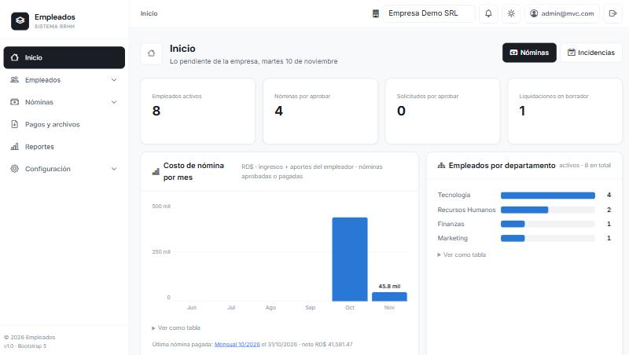
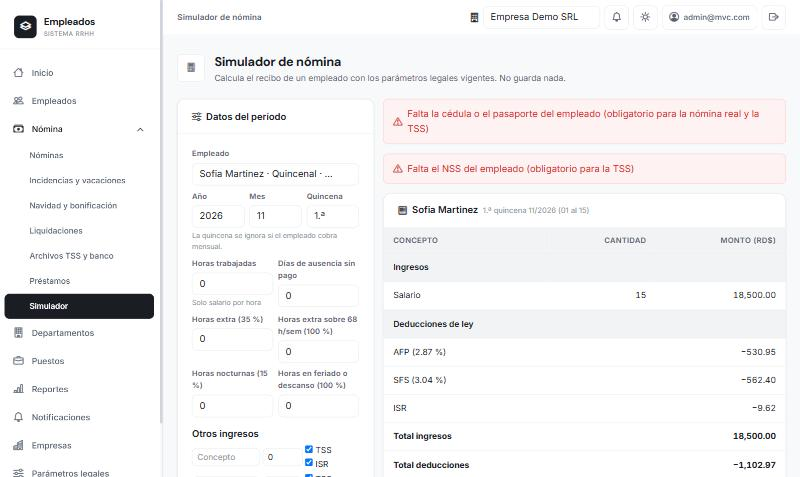
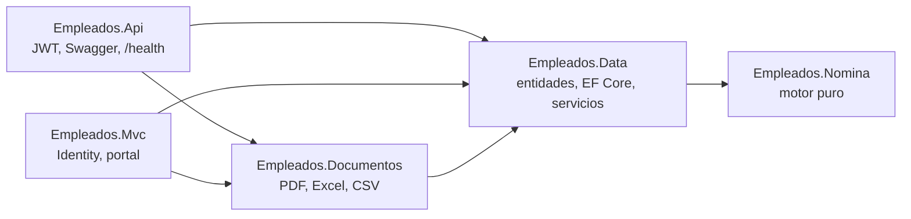

# Empleados: nómina y RRHH para República Dominicana

> **Copia de referencia del README del proyecto.** El código fuente está en un repositorio privado; aquí se conserva la documentación técnica (instalación, arquitectura, funciones y API) para que se pueda leer completa. Las instrucciones de instalación describen cómo corre el proyecto en el repositorio privado. Para una vista general, empieza por el [README](README.md).

Sistema multiempresa de recursos humanos y nómina en ASP.NET Core 10: calcula nóminas quincenales y mensuales con TSS (AFP, SFS, SRL, INFOTEP) e ISR, Salario de Navidad, bonificación, liquidaciones de prestaciones, préstamos, vacaciones e incidencias; genera recibos en PDF, reportes en Excel/CSV/PDF y los archivos de la TSS; y ofrece un portal para que cada empleado vea sus recibos.

Son **dos aplicaciones independientes** (Web API con JWT y Web MVC con Identity) sobre la misma base de datos y la misma lógica de negocio. Es un proyecto de portafolio: las cifras legales vienen de fuentes secundarias y deben validarse con la DGII, la TSS y el Ministerio de Trabajo antes de usarse con nóminas reales (por eso viven como parámetros con fecha de vigencia, no en el código).

| Inicio | Simulador de nómina |
|---|---|
|  |  |

## Qué demuestra este proyecto

- **Un motor de cálculo puro y probado.** `Empleados.Nomina` no conoce la base de datos, la web ni el reloj: entradas a recibo, con la explicación paso a paso de cada cifra. Se valida con *golden tests* de los casos de [docs/CASOS_NOMINA.md](docs/CASOS_NOMINA.md).
- **Reglas legales como datos.** Tasas, topes, escala de ISR, salarios mínimos y feriados se guardan con fecha de vigencia; cuando cambia la ley se registra una vigencia nueva.
- **Fronteras de proyecto protegidas por pruebas**, no solo por convención (ver Arquitectura).
- **Concurrencia y consistencia.** Pagar una nómina dos veces a la vez es imposible (token de concurrencia en SQL Server), probado contra un SQL Server real.
- **Decisiones registradas.** Cada decisión de diseño tiene un ADR con sus alternativas descartadas y lo que *no* se hizo y por qué: [docs/decisiones](docs/decisiones).

## Requisitos Previos

- [.NET 10 SDK](https://dotnet.microsoft.com/download/dotnet/10.0)
- Herramienta EF Core: `dotnet tool install -g dotnet-ef` (o `dotnet tool update -g dotnet-ef`)
- [SQL Server Express](https://www.microsoft.com/es-es/sql-server/sql-server-downloads) o LocalDB
- [SQL Server Management Studio (SSMS)](https://docs.microsoft.com/en-us/sql/ssms/download-sql-server-management-studio-ssms) (opcional)
- [Visual Studio 2026](https://visualstudio.microsoft.com/es/) (o VS Code con C# Dev Kit) con las cargas de trabajo:
  - ASP.NET and web development
  - .NET desktop development
  - Data storage and processing

## Estructura del Proyecto

```text
EmpleadosSolution/
├── Empleados.Nomina/        # Motor de cálculo puro (sin BD ni web ni reloj)
├── Empleados.Data/          # Entidades, DbContext, migraciones, servicios de negocio, correo, fotos
├── Empleados.Documentos/    # PDF (QuestPDF), Excel y CSV; depende de Data, no al revés
├── Empleados.Api/           # Web API (REST, JWT, Swagger, /health)
├── Empleados.Mvc/           # Web MVC (Razor, Identity, portal del empleado)
├── Empleados.Tests/         # xUnit: unidad, golden tests, arquitectura y SQL Server real
└── docs/                    # Plan, casos de nómina y docs/decisiones (ADR)
```

## Configuración Inicial

### 1. Obtener el código
El código está en un repositorio privado; se puede dar acceso a quien lo necesite para evaluarlo. Desde la raíz de la solución:

### 2. Restaurar paquetes
```bash
dotnet restore Empleados.Api/Empleados.Api.csproj
dotnet restore Empleados.Mvc/Empleados.Mvc.csproj
dotnet restore Empleados.Tests/Empleados.Tests.csproj
```

### 3. Configurar la cadena de conexión
Asegúrate de que `appsettings.json` en ambos proyectos (Api y Mvc) tenga la conexión correcta:
```json
{
  "ConnectionStrings": {
    "DefaultConnection": "Server=(localdb)\\mssqllocaldb;Database=EmpleadosDB;Trusted_Connection=True;MultipleActiveResultSets=true;TrustServerCertificate=True"
  }
}
```

### 4. Configurar la clave JWT de la API
La clave no se guarda en el repositorio. En desarrollo va en *user-secrets* (mínimo 32 caracteres):
```bash
dotnet user-secrets set "Jwt:Key" "una-clave-larga-y-aleatoria-de-al-menos-32-caracteres" --project Empleados.Api
```
En producción usa la variable de entorno `Jwt__Key`. Sin esta clave la API no arranca.

Los orígenes permitidos por CORS se configuran en `Cors:AllowedOrigins` de `Empleados.Api/appsettings.json`.

**Fotos de empleados:** la API y el MVC guardan y sirven las fotos (en `/uploads`) desde la misma carpeta, configurada en `Uploads:Path` de ambos `appsettings.json`. Por defecto es `../uploads`, la carpeta `uploads/` en la raíz de la solución, que no se versiona. En producción usa la misma ruta absoluta en las dos apps.

### 5. Aplicar migraciones a la base de datos
```bash
dotnet ef database update --project Empleados.Data --startup-project Empleados.Api
```

### 6. Compilar el proyecto
```bash
dotnet build
```

## Ejecutar la Aplicación

Debes ejecutar las dos aplicaciones en terminales separadas.

**Terminal 1: Web API**
```bash
dotnet run --project Empleados.Api
```
- HTTPS: `https://localhost:7114`
- Swagger: `https://localhost:7114/swagger`

**Terminal 2: Web MVC**
```bash
dotnet run --project Empleados.Mvc
```
- HTTPS: `https://localhost:7293`

**Datos de demostración (solo desarrollo):** crea la empresa *Distribuidora del Caribe SRL* con 34 empleados, préstamos, incidencias, las nóminas de enero a octubre de 2026 calculadas con el motor real, la bonificación 2025 y dos liquidaciones. Octubre queda a medio ciclo para ver la aprobación. Si ya existe, no se duplica.
```bash
dotnet run --project Empleados.Mvc -- --demo
```

## Usuarios de desarrollo

Al arrancar el MVC en desarrollo se crean un administrador y un usuario de RRHH de prueba **solo si sus contraseñas están configuradas** en `SeedUsers` (`appsettings.Development.json` o *user-secrets*). El administrador de prueba recibe también el rol `SuperAdmin` (la plataforma). Las contraseñas nuevas deben tener al menos 8 caracteres, con mayúscula, minúscula y número. Las mismas credenciales sirven para `/api/Auth/login`.

## Ejecutar Pruebas Unitarias
```bash
dotnet test
```
*Nota: La suite incluye 229 pruebas (7 de ellas contra SQL Server real, opcionales) que validan los casos de nómina de [docs/CASOS_NOMINA.md](docs/CASOS_NOMINA.md), el motor de cálculo, reportes, integridad referencial, notificaciones, reglas de negocio, subida de fotos, aislamiento entre empresas (con pruebas guardia), respaldos y restauración, parámetros legales por vigencia, datos de nómina, historial de movimientos, feriados de la Ley 139-97, vacaciones, incidencias, Salario de Navidad, bonificación y prestaciones laborales.*

**Salud:** `GET /health` (API y MVC) responde `Healthy` si la aplicación llega a la base de datos.

**Pruebas contra SQL Server real (opcional en local):** definen `EMPLEADOS_TEST_SQL` con la cadena de conexión a una instancia (sin base de datos); cada clase crea y borra su propia base. Sin la variable se omiten. En CI corren en un job con un contenedor de SQL Server.

```powershell
$env:EMPLEADOS_TEST_SQL = 'Server=localhost\SQLEXPRESS;Integrated Security=true;TrustServerCertificate=true'
dotnet test --filter Categoria=Integracion
```

**CI:** cada push a la rama principal y cada PR ejecutan en GitHub Actions (`.github/workflows/ci.yml`) la compilación, los tests y una revisión de que el modelo de EF coincide con las migraciones desde la API y desde el MVC.

## Arquitectura



La lógica de negocio vive en `Empleados.Data/Services` y la comparten la API y el MVC: las reglas son las mismas en las dos aplicaciones, y los controladores solo traducen el resultado del servicio a HTTP o a vistas. Las flechas son "depende de"; `ArquitecturaTests` falla si `Data` vuelve a referenciar los documentos o QuestPDF, o si el motor de nómina referencia algo del proyecto.

### Decisiones de diseño

| Decisión | Resumen | ADR |
|---|---|---|
| Reloj inyectable | `TimeProvider` en vez de `DateTime.Now`: fechas de nómina deterministas en pruebas | [001](docs/decisiones/001-reloj-inyectable.md) |
| Lecturas eficientes | Proyección a DTO, `AsNoTracking` y filtro de fecha como rango (sargable) | [002](docs/decisiones/002-lecturas-eficientes.md) |
| Reglas en la entidad | `Empleado` protege sus transiciones de estado; "despedido" es estado final | [003](docs/decisiones/003-reglas-de-estado-en-la-entidad.md) |
| Fronteras de proyecto | Documentos separado; por qué *no* se partió Dominio/Aplicación/Infraestructura | [004](docs/decisiones/004-separar-documentos-y-fronteras.md) |
| Pruebas con SQL real | Migraciones, índices, claves foráneas y concurrencia; encontró un bug real | [005](docs/decisiones/005-pruebas-contra-sql-server-real.md) |
| Observabilidad | Logs estructurados sin datos sensibles, `ProblemDetails`, `/health` | [006](docs/decisiones/006-observabilidad.md) |
| Autenticación | Cookie en el MVC, JWT en la API; políticas, bloqueo y límite de intentos | [007](docs/decisiones/007-autenticacion-y-autorizacion.md) |
| Decisiones de producto | Tope de cuota de préstamos, envío automático de recibos, SaaS | [008](docs/decisiones/008-decisiones-de-producto.md) |
| Aislamiento entre empresas | Auditoría, rol de plataforma, registro y planes | [009](docs/decisiones/009-aislamiento-multiempresa.md) |
| Respaldos | Programados, descarga solo de la plataforma y restauración probada | [010](docs/decisiones/010-respaldos.md) |

Los planes (mejora de arquitectura y de producto) están en [docs/PLAN_MEJORAS.md](docs/PLAN_MEJORAS.md) y [docs/PLAN_PRODUCTO.md](docs/PLAN_PRODUCTO.md). El sistema nació como una gestión de empleados y evolucionó hacia nómina; ese plan está en [docs/PLAN_NOMINA.md](docs/PLAN_NOMINA.md).

### Motor de cálculo de nómina
`Empleados.Nomina` es una librería sin base de datos ni web. Recibe el empleado, el período (quincenal o mensual), las horas extra, las ausencias, los otros ingresos y las deducciones, junto con los parámetros legales vigentes, y devuelve el recibo:
- **Ingresos:** salario, prorrateo, ausencias, horas extra y recargos.
- **Deducciones de ley:** AFP y SFS con topes mensuales, e ISR.
- **Deducciones internas** y **aportes del empleador** (AFP, SFS, SRL e INFOTEP).
- Una **explicación paso a paso** de cada cálculo.

En la pantalla **Nóminas → Simulador** y en `POST /api/Nomina/simular` se prueba con los datos reales de un empleado, sin guardar nada.

### Ciclo de nómina
**Nóminas → Nóminas** maneja una nómina por empresa, período (quincena o mes) y frecuencia.
- **Borrador / Calculada:** incluye a los empleados activos con esa frecuencia. Se cargan las **novedades** de cada recibo (horas extra, ausencias, bonos, descuentos) y se recalcula las veces que haga falta.
- **Aprobada** (solo Admin): no se puede aprobar si algún recibo tiene errores, por ejemplo si falta la cédula o el NSS. La 2.ª quincena solo se calcula con la 1.ª aprobada, porque usa lo ya retenido. Una nómina aprobada se puede **reabrir** mientras no se haya pagado.
- **Pagada:** ya no se modifica, y baja el saldo de los **préstamos en cuotas** (Empleados → Préstamos).
- **Cerrada:** cierre del período.

**Nóminas → Navidad y bonificación** crea la nómina del **Salario de Navidad** (1/12 del salario ordinario del año, sin TSS ni ISR) y reparte la **Bonificación** (10 % de la utilidad con tope de 45 o 60 días), que se paga como ingreso en una nómina regular.

**Empleados → Liquidaciones** calcula las prestaciones al terminar el contrato según la causa (preaviso, cesantía, asistencia económica, vacaciones y Navidad proporcionales, menos los saldos de préstamos). Genera el PDF con el recibo de descargo; al marcarla pagada, el empleado sale de la empresa.

**Pagos y archivos** genera la autodeterminación mensual de la TSS (AM) desde las nóminas aprobadas, el resumen de aportes e ISR del mes, el CSV de pago al banco y la planilla de personal (base de la DGT-3).

**Portal del empleado:** desde la ficha del empleado, el Admin le da acceso (usuario con su correo y contraseña temporal). El empleado ve sus recibos pagados y su saldo de vacaciones, pide vacaciones o permisos y descarga su carta de trabajo. Los recibos se envían por correo **a mano** desde la nómina o **automáticamente al pagarla** si la empresa activa ese interruptor (apagado por defecto); configure la sección `Correo` (Host, Puerto, Usuario, Clave, Remitente). **Sin `Host` no se envía nada:** los correos se guardan como archivos .eml en `../correos`, pensado para desarrollo.

**Desplegables:** todos los `<select class="form-select">` usan el componente Smart Select (buscador, carga progresiva, menú que no se recorta). Las reglas están en [docs/ESTANDAR_DESPLEGABLES.md](docs/ESTANDAR_DESPLEGABLES.md).

**Reportes:** 12 reportes de personal (plantilla, por departamento, cumpleaños, contratos por vencer), nómina (costo por departamento, detalle de una nómina, comparativo mensual, acumulados, préstamos) y asistencia (ausentismo, vacaciones pendientes, rotación), con filtros por año, mes, departamento, estado o nómina, y descarga en Excel (.xlsx), CSV o PDF. Cada nómina tiene además un **PDF resumen** con una fila por empleado.

**Empleados → Incidencias y vacaciones** registra faltas, retardos, permisos, licencias y vacaciones (también colectivas). Al aprobarse, las faltas, los retardos y los permisos sin goce se descuentan solos en la nómina del período. Las vacaciones se validan contra el saldo del año de servicio, visible en la ficha del empleado. En **Parámetros legales** se generan los feriados de cualquier año con los traslados de la Ley 139-97.

Cada recibo guarda una copia de los datos del empleado, sus líneas y la explicación del cálculo, y se descarga en **PDF** (uno o todos los de la nómina). Mientras la nómina no esté pagada, el PDF lleva la marca BORRADOR. Las reglas de cálculo y los casos para validarlas están en [docs/CASOS_NOMINA.md](docs/CASOS_NOMINA.md).

### Multiempresa (SaaS)
- Cada departamento, puesto y empleado pertenece a una **empresa** (empleador con su RNC). Un filtro global de EF Core aplica esa regla a todas las consultas, y pruebas guardia fallan si una tabla con `EmpresaId` no lo tiene o si aparece un `IgnoreQueryFilters` nuevo ([ADR 009](docs/decisiones/009-aislamiento-multiempresa.md)).
- **Roles:** `SuperAdmin` (la plataforma: todas las empresas, parámetros legales y respaldos), `Admin` (administra solo las empresas a las que pertenece), `RRHH` y `Empleado` (portal).
- **Registro de empresas** (`/Registro`): crea la empresa en plan de prueba y a su administrador. Está **cerrado por defecto** (`Plataforma:RegistroAbierto`) y limitado por IP.
- **Planes** con límite de empleados (Prueba 10, Básico 50, Profesional 250); solo la plataforma los cambia.
- **Usuarios por empresa:** el administrador crea usuarios de su empresa; solo ve a los de las suyas.
- **MVC:** la empresa se elige en el selector de la barra superior. **API:** se envía en la cabecera `X-Empresa-Id`; si se pide una no asignada, no se devuelven datos.

### Respaldos
Respaldo completo con `BACKUP DATABASE`, programado (al arrancar si el último tiene más de 24 horas y cada día a las 2:00) y con retención configurable (`Respaldos:Carpeta`, `Respaldos:DiasRetencion`). Solo `SuperAdmin` los ve y descarga; cada descarga se registra. El administrador de una empresa puede **exportar sus datos** en JSON. Una prueba contra SQL Server real crea un respaldo y lo restaura en otra base ([ADR 010](docs/decisiones/010-respaldos.md)).

### Pantallas y flujos
Listados con búsqueda, filtros y paginación (empleados, departamentos con ficha, puestos con nivel, plazas y requisitos, nóminas, liquidaciones, incidencias y notificaciones), indicador de pasos en nóminas y liquidaciones, asistente de **vacaciones colectivas** con vista previa, notificaciones como bitácora y un **Inicio con gráficos** (costo de nómina por mes y empleados por departamento). Qué hace cada módulo y las decisiones de producto están en [docs/FLUJOS.md](docs/FLUJOS.md) y [docs/PLAN_PRODUCTO.md](docs/PLAN_PRODUCTO.md).

### Parámetros legales
Las tasas de TSS (AFP, SFS y SRL) y sus topes, la escala de ISR, los salarios mínimos por tamaño de empresa, los feriados y los valores del Código de Trabajo se guardan **con fecha de vigencia** (pantalla **Parámetros legales**). Cuando cambia la ley se registra una vigencia nueva y los valores anteriores no se modifican. Los valores iniciales de 2026 salen de fuentes secundarias y deben verificarse con la DGII, la TSS y el Ministerio de Trabajo.

### Datos de nómina del empleado
Documento (cédula o pasaporte), NSS, AFP, ARS, dependientes del SFS, tipo de contrato, frecuencia de pago (por defecto la de la empresa), tipo de salario y cuenta bancaria. Al crear o editar un empleado se valida que el salario no sea menor que el mínimo vigente para el tamaño de la empresa. Cada alta y cada cambio de salario, puesto, departamento, frecuencia o estado queda en el **historial de movimientos**.

## Endpoints de la API

Todos requieren token JWT, salvo el login. Crear, editar o eliminar departamentos, puestos y empleados, y subir fotos, requiere rol **Admin**. Desactivar y despedir requiere **Admin** o **RRHH**.

| Método | Endpoint | Descripción |
|--------|----------|-------------|
| GET | `/api/Empresas` | Empresas del usuario y empresa actual |
| GET | `/api/Parametros?fecha=2026-03-01` | Parámetros legales vigentes en una fecha |
| GET | `/api/Parametros/isr?fecha=…` | Escala anual de ISR vigente |
| GET | `/api/Parametros/salarios-minimos` | Salarios mínimos por tamaño de empresa |
| GET | `/api/Parametros/feriados/2026` | Feriados del año |
| POST | `/api/Nomina/simular` | Simula el recibo de un empleado en un período (Admin o RRHH) |
| GET / POST | `/api/Nominas` | Lista nóminas / crea y calcula la nómina de un período |
| GET | `/api/Nominas/5` | Nómina con sus recibos |
| POST | `/api/Nominas/5/calcular` · `aprobar` · `reabrir` · `pagar?fechaPago=` · `cerrar` | Ciclo de la nómina (aprobar, reabrir, pagar y cerrar: solo Admin) |
| PUT | `/api/Nominas/recibos/7/novedades` | Novedades de un recibo (recalcula) |
| GET | `/api/Nominas/recibos/7/pdf` | Recibo en PDF |
| GET / POST | `/api/Prestamos` | Préstamos en cuotas |
| GET / POST | `/api/Incidencias` | Faltas, retardos, permisos, licencias y vacaciones |
| POST / DELETE | `/api/Incidencias/5/aprobar` · `rechazar?motivo=` · `/api/Incidencias/5` | Aprobar, rechazar o eliminar |
| GET | `/api/Incidencias/vacaciones/5` | Saldo de vacaciones del empleado |
| POST | `/api/Incidencias/colectivas` | Vacaciones colectivas |
| GET / POST / DELETE | `/api/Liquidaciones` · `/api/Liquidaciones/5` · `/5/pdf` · `/5/pagar?fechaPago=` | Liquidaciones de prestaciones (pagar: solo Admin) |
| GET | `/api/Archivos/tss/2026/10` · `/txt` · `/api/Archivos/dispersion/5?bancoId=` · `/api/Archivos/planilla` | Autodeterminación TSS, pago al banco y planilla |
| GET | `/api/Reportes/catalogo` · `/api/Reportes/{tipo}?anio=&mes=&departamentoId=&estado=&nominaId=` | Catálogo de reportes y cada reporte en JSON |
| GET | `/api/Nominas/5/resumen-pdf` | PDF resumen de la nómina |
| POST | `/api/Nominas/5/enviar-recibos` | Envía los recibos por correo (solos al pagar si la empresa lo activa) |
| POST | `/api/PagosEspeciales/salario-navidad?anio=` | Crea y calcula el Salario de Navidad |
| GET / POST | `/api/PagosEspeciales/bonificacion?anioFiscal=&utilidad=` (`&nominaId=` al aplicar) | Reparto de la bonificación y su aplicación |

### Empleados
| Método | Endpoint | Descripción |
|--------|----------|-------------|
| GET | `/api/Empleados?page=1&pageSize=10` | Listado paginado con filtros |
| GET | `/api/Empleados/5` | Obtener empleado por ID |
| POST | `/api/Empleados` | Crear empleado (genera notificación automática) |
| PUT | `/api/Empleados/5` | Actualizar empleado |
| PATCH | `/api/Empleados/5/desactivar` | Desactivar empleado |
| PATCH | `/api/Empleados/5/despedir` | Despedir empleado |
| POST | `/api/Empleados/5/foto` | Subir foto (multipart/form-data) |

### Departamentos y Puestos
| Método | Endpoint | Descripción |
|--------|----------|-------------|
| GET | `/api/Departamentos` | Listar departamentos |
| POST | `/api/Departamentos` | Crear departamento |
| GET | `/api/Puestos?departamentoId=X` | Listar puestos filtrados por departamento |
| POST | `/api/Puestos` | Crear puesto (valida existencia de departamento) |

### Reportes y Notificaciones
| Método | Endpoint | Descripción |
|--------|----------|-------------|
| GET | `/api/Reportes/Departamentos` | Métricas agregadas (Total, Activos, Nómina) |
| GET | `/api/Notificaciones/mis-notificaciones` | Obtener notificaciones del usuario autenticado |
| POST | `/api/Notificaciones/marcar-leida/{id}` | Marcar notificación como leída |

### Autenticación (API)
| Método | Endpoint | Descripción |
|--------|----------|-------------|
| POST | `/api/Auth/login` | Obtener token JWT |

## Tecnologías Utilizadas

- **.NET 10** (LTS, soporte hasta noviembre de 2028), **ASP.NET Core Web API** y **MVC**
- **Entity Framework Core** (Code First) sobre **SQL Server** (LocalDB / Express)
- **ASP.NET Core Identity** (cookie en el MVC) y **JWT Bearer** (API), limitador de tasa y cabeceras de seguridad
- **QuestPDF** para los PDF; Excel (.xlsx) generado sin dependencias
- **xUnit** con EF InMemory para la lógica y **SQL Server real** para lo que depende del motor; **GitHub Actions** para CI
- **Bootstrap 5** + Bootstrap Icons, **CSS Design Tokens** (modo claro/oscuro) y **Swagger/OpenAPI** (Swashbuckle)

## Funcionalidades Avanzadas Implementadas

### 1. Módulo de Reportes Ejecutivos
- Dashboard con métricas agregadas en tiempo real por departamento.
- Consultas LINQ optimizadas para evitar carga innecesaria en memoria.
- Formato de moneda local y visualización responsiva.

### 2. Integridad Referencial de Puestos
- Los puestos están vinculados estrictamente a departamentos mediante Foreign Key.
- Validación cruzada en API y MVC: no se puede asignar un puesto de otro departamento a un empleado.
- Filtros dinámicos en frontend: al seleccionar un departamento, los puestos disponibles se actualizan vía AJAX.

### 3. Sistema de Notificaciones Internas
- Alertas automáticas ante eventos (nuevo empleado, recordatorios diarios de cumpleaños, fin de período de prueba y vacaciones por vencer).
- Pantalla tipo bitácora con búsqueda, filtros y paginación; marcar leída una o todas; las leídas se borran a los 90 días.
- Campana en la barra superior con polling asíncrono (30 s) y contador.

### 4. Rediseño UI/UX Moderno (3 Fases)
- **Sistema de Diseño:** Variables CSS (:root y [data-theme="dark"]) para transiciones suaves y detección de preferencia del sistema.
- **Componentes Reutilizables:** Partials de Razor para _BadgeEstado, _EmptyState y _StatCard, eliminando duplicación de estilos.
- **Accesibilidad WCAG AA:** Anillos de foco visibles (focus-visible), ratios de contraste 16:1 y jerarquía tipográfica clara (Inter / DM Sans).
- **Área de Identity:** Rediseño completo de `/Account/Manage` para coincidir con el sistema de diseño global.

## Reglas de Negocio

- Desactivar no es igual a Despedir (estados mutuamente excluyentes).
- No se permite la eliminación física de empleados (soft delete mediante cambio de estado).
- No se puede eliminar un departamento si tiene puestos o empleados asociados.
- Un empleado despedido no puede ser modificado ni desactivado: la regla está en la propia entidad (`Empleado.Despedir`, `Desactivar`, `ComprobarModificable`).
- Un puesto solo puede ser asignado a un empleado si pertenece al mismo departamento que el empleado.

## Autor

- **Joel Starling Florian del Rosario** - [GitHub](https://github.com/Joel-S-Florian)

## Licencia

Proyecto educativo y de portafolio, sin fines comerciales. Todos los derechos reservados sobre el código fuente (repositorio privado); esta documentación y las capturas se publican para evaluación.
