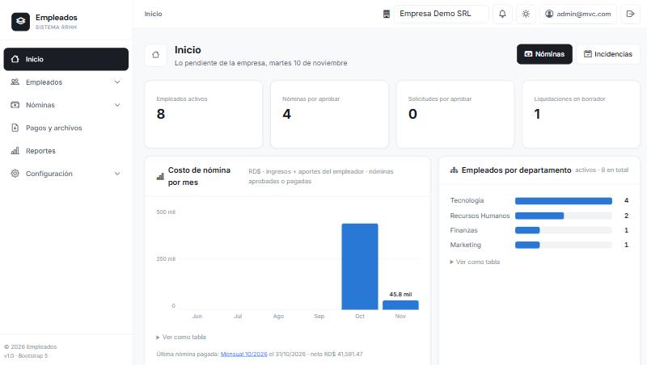
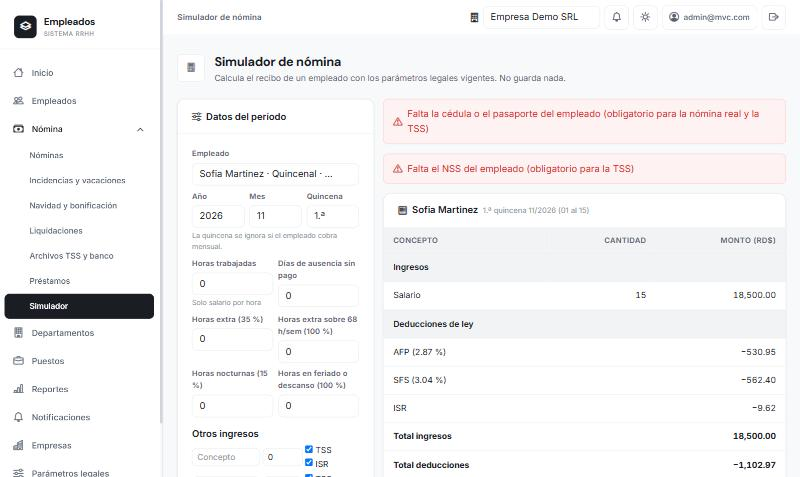
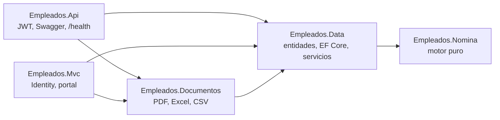

# Empleados: nómina y RRHH para República Dominicana

> **Vitrina del proyecto.** El código fuente está en un repositorio privado; aquí están las capturas, la arquitectura y las decisiones de diseño. Con gusto doy acceso al código o hago una demostración en una entrevista.

**In short (EN):** a multi-company payroll and HR system for the Dominican Republic, built with ASP.NET Core 10 (Web API + MVC), EF Core and SQL Server. A pure, tested payroll engine (social security and income-tax withholding, severance, Christmas bonus), versioned legal parameters, company isolation audited with guard tests, and 10 architecture decision records. Documentation is in Spanish.

## Cómo se ve

| Inicio | Simulador de nómina |
|---|---|
|  |  |

## Qué hace

- **Nómina** quincenal y mensual con TSS (AFP, SFS, SRL, INFOTEP) e ISR, Salario de Navidad, bonificación, préstamos en cuotas, vacaciones e incidencias.
- **Liquidaciones** de prestaciones según la causa de terminación, con PDF del recibo de descargo.
- **Documentos y reportes:** recibos en PDF, 12 reportes con exportación a Excel, CSV y PDF, y los archivos de la TSS y del banco.
- **Portal del empleado** para ver recibos, pedir vacaciones y descargar su carta de trabajo.
- **SaaS multiempresa:** registro de empresas, planes con límite de empleados, roles de plataforma y de empresa, respaldos y exportación de datos por empresa.

## Qué demuestra

- **Un motor de cálculo puro y probado.** `Empleados.Nomina` no conoce la base de datos, la web ni el reloj: entradas a recibo, con la explicación paso a paso de cada cifra, validado con *golden tests*.
- **Reglas legales como datos.** Tasas, topes, escala de ISR, salarios mínimos y feriados con fecha de vigencia: cuando cambia la ley se registra una vigencia nueva y los recibos anteriores siguen siendo reproducibles.
- **Fronteras protegidas por pruebas**, no solo por convención: una prueba de arquitectura falla si la capa de datos vuelve a depender de la librería de PDF.
- **Concurrencia.** Pagar una nómina dos veces a la vez es imposible (token de concurrencia en SQL Server). La prueba contra SQL real **encontró un bug real** antes de que lo hiciera un usuario.
- **Aislamiento entre empresas auditado.** Un filtro global de EF Core por empresa, más pruebas guardia que fallan si una tabla nueva no lo tiene o aparece un `IgnoreQueryFilters` nuevo.
- **Respaldos con restauración probada.** Una prueba crea un respaldo y lo restaura en una base limpia.
- **Decisiones registradas.** Cada decisión importante tiene un ADR con sus alternativas descartadas y lo que *no* se hizo, y por qué.

## Arquitectura

Dos aplicaciones independientes (una API con JWT y un sitio MVC con Identity) comparten la base de datos y la misma lógica de negocio. Las flechas son "depende de".

## Decisiones de diseño

| Decisión | Resumen | ADR |
|---|---|---|
| Reloj inyectable | `TimeProvider` en vez de `DateTime.Now`: fechas de nómina deterministas en pruebas | [001](docs/decisiones/001-reloj-inyectable.md) |
| Lecturas eficientes | Proyección a DTO, `AsNoTracking` y filtro de fecha como rango | [002](docs/decisiones/002-lecturas-eficientes.md) |
| Reglas en la entidad | `Empleado` protege sus transiciones de estado | [003](docs/decisiones/003-reglas-de-estado-en-la-entidad.md) |
| Fronteras de proyecto | Documentos separado; por qué *no* se partió en Dominio/Aplicación/Infraestructura | [004](docs/decisiones/004-separar-documentos-y-fronteras.md) |
| Pruebas con SQL real | Migraciones, índices, claves foráneas y concurrencia | [005](docs/decisiones/005-pruebas-contra-sql-server-real.md) |
| Observabilidad | Logs sin datos sensibles, `ProblemDetails`, `/health` | [006](docs/decisiones/006-observabilidad.md) |
| Autenticación | Cookie en el MVC, JWT en la API; políticas, bloqueo y límite de intentos | [007](docs/decisiones/007-autenticacion-y-autorizacion.md) |
| Decisiones de producto | Tope de cuota de préstamos, envío automático de recibos, SaaS | [008](docs/decisiones/008-decisiones-de-producto.md) |
| Aislamiento entre empresas | Auditoría, rol de plataforma, registro y planes | [009](docs/decisiones/009-aislamiento-multiempresa.md) |
| Respaldos | Programados, descarga solo de la plataforma y restauración probada | [010](docs/decisiones/010-respaldos.md) |

## Cifras

- **229 pruebas automatizadas**, 7 de ellas contra SQL Server real (golden tests, arquitectura, aislamiento y respaldos).
- **6 proyectos** en .NET 10, integración continua con GitHub Actions y **10 ADR**.
- Todo el trabajo de mejora está documentado: [plan de arquitectura](docs/PLAN_MEJORAS.md) y [plan de producto](docs/PLAN_PRODUCTO.md).

## Estado y límites

Es un proyecto de portafolio, **no un producto listo para el público**:
- Las cifras legales vienen de fuentes secundarias y deben validarse con la DGII, la TSS y el Ministerio de Trabajo antes de usarse con nóminas reales; por eso viven como parámetros con vigencia y no en el código.
- Antes de abrir el registro de empresas al público faltan la confirmación de correo, la recuperación de contraseña y roles por empresa. Está anotado, con la condición para cada uno, en los ADR 009 y 010.

## Para leer más

- [README técnico](README-TECNICO.md): instalación, funciones, endpoints de la API y reglas de negocio.
- [docs/FLUJOS.md](docs/FLUJOS.md): qué hace cada módulo y las decisiones de producto.
- [docs/CASOS_NOMINA.md](docs/CASOS_NOMINA.md): los casos de nómina que validan el motor.

## Autor

**Joel Starling Florian del Rosario**: [GitHub](https://github.com/Joel-S-Florian)

Proyecto educativo y de portafolio, sin fines comerciales. Todos los derechos reservados sobre el código fuente.
