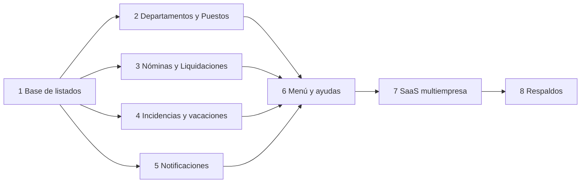

# Plan de producto: de la revisión de usabilidad al desarrollo

Origen: revisión del 2026-11-09 (ver [FLUJOS.md](FLUJOS.md)) y decisiones del [ADR 008](decisiones/008-decisiones-de-producto.md). Sustituye a la "cola" de las fases 9 a 13 de [PLAN_MEJORAS.md](PLAN_MEJORAS.md): aquí cada una tiene alcance, orden y criterio de terminado.

## Cómo se trabaja
- **Una etapa = una rama = un PR pequeño**, con pruebas. Se empieza por la base que reutilizan las demás.
- **Cada etapa cierra con:** `dotnet build` y `dotnet test` en verde, migración revisada si hay cambio de esquema, y comprobación en pantalla (la app corre en `http://localhost:5203`).
- **Regla de paginación:** tope máximo de página en el servidor; los catálogos acotados no se paginan, pero sí se buscan.

## Ya hecho (no repetir)
Meses con mayúscula · quincena deshabilitada en nómina mensual · recibos enviados arriba · préstamos por número de cuotas · tope de cuota 30 % · ayuda de causas de terminación · envío automático de recibos por empresa.

## Orden de las etapas

Las etapas 2 a 5 son independientes entre sí una vez hecha la 1. SaaS y respaldos van al final porque tocan todo y dependen del resto estable.

---

## Etapa 1 · Base de listados: búsqueda + filtros + paginación · M · HECHA (salvo migrar Empleados a la vista parcial)
**Por qué primero:** cinco etapas la necesitan; hacerla una vez evita cinco versiones distintas.
- **Qué:** un patrón único para listados: servicio recibe `(buscar, filtros, pagina, tamano)`, devuelve `Paginado<T>` (ya existe, Fase 2) con tope de tamaño; vista parcial reutilizable `_Paginacion` (anterior/siguiente, "mostrando X–Y de N") y caja de búsqueda que conserva los filtros en la URL.
- **Dónde:** helper en `Empleados.Data/Services` (generalizar `EmpleadoService.NormalizarPagina`), parcial en `Empleados.Mvc/Views/Shared`.
- **Pruebas:** tamaño de página fuera de rango, página inexistente, búsqueda sin acentos ni mayúsculas, orden estable.
- **Terminado cuando:** Empleados usa el helper sin cambiar su comportamiento (prueba de regresión) y existe una vista parcial lista.
- **Decisión de diseño a explicar:** `Skip/Take` frente a cursor (ver Fase 9 del plan).

## Etapa 2 · Departamentos y Puestos · S–M · HECHA
- **Departamentos:** detalle con la lista de sus empleados (nombre, puesto, estado, salario solo para roles con permiso), contadores (activos, nómina mensual) y sus puestos. Búsqueda y paginación.
- **Puestos:** hoy tienen nombre, descripción, departamento y rango salarial. Se agregan: nivel (junior/semi/senior/gerencia), requisitos, funciones, cantidad de plazas y activo/inactivo; el detalle muestra quién lo ocupa. **Migración** con valores por defecto.
- **Regla nueva a probar:** el salario de un empleado fuera del rango de su puesto da advertencia (no error).
- **Terminado cuando:** se puede abrir un departamento y ver a sus empleados; un puesto guarda los campos nuevos; hay pruebas de las consultas con el filtro de empresa.

## Etapa 3 · Nóminas y Liquidaciones: búsqueda y flujo claro · M · HECHA
- **Nóminas:** búsqueda y filtros (año, mes, frecuencia, estado, tipo), paginación. En la pantalla de nueva nómina, texto que explique frecuencia y quincena. En el detalle, un indicador de pasos (Borrador → Calculada → Aprobada → Pagada → Cerrada) con la acción siguiente destacada.
- **Liquidaciones:** búsqueda por empleado, causa, estado y fechas; paginación; acciones ordenadas por estado (calcular, aprobar, pagar), sin botones que no apliquen.
- **Terminado cuando:** ambas se filtran por URL, el estado actual y la siguiente acción son evidentes y una prueba cubre el filtro combinado.

## Etapa 4 · Incidencias y vacaciones · M · HECHA
- **Consulta global de incidencias** (pantalla propia, fuera del detalle del empleado): filtros por empleado, tipo, estado y rango; paginación; desde ahí se llega al empleado.
- **Vacaciones colectivas:** hoy `VacacionesColectivasAsync` es difícil de entender. Se reemplaza el formulario por un asistente de tres pasos: (1) fechas y motivo, (2) a quién aplica (toda la empresa o un departamento) con vista previa de empleados y de los días que se descontarán, (3) confirmar. Los empleados sin saldo suficiente se avisan antes de aplicar.
- **Pruebas:** vista previa igual al resultado aplicado, empleados sin saldo, empleado despedido excluido.
- **Terminado cuando:** una persona nueva completa unas vacaciones colectivas sin instrucciones y la vista previa coincide con lo aplicado.

## Etapa 5 · Notificaciones (Fase 10) · M · HECHA
- **Decisiones previas (rápidas, antes de codificar):** retención (30/90 días), tipos y severidad (info/aviso/error), y si habrá correo.
- **Qué:** pantalla estilo bitácora (monoespaciada, una línea por evento con hora, color por severidad, agrupación por día), búsqueda y filtro por tipo y leída/no leída, paginación, marcar como leída una o todas (también desde la campana), y limpieza de las antiguas.
- **Pruebas:** marcar todas solo afecta al usuario actual; no se duplican los recordatorios del día (con `FakeTimeProvider`).
- **Terminado cuando:** la bitácora filtra, pagina y marca leídas desde las dos pantallas, y la campana muestra el mismo conteo.

## Etapa 6 · Menú, ayudas y simulador · S · HECHA
- **Menú en cinco áreas:** Empleados · Nóminas · Pagos y archivos · Reportes · Configuración (ver mapa en FLUJOS.md). Solo navegación, sin mover código.
- **Textos de ayuda** (una frase y un "¿qué es esto?" desplegable) en Navidad y bonificaciones, Archivos TSS/Banco/Planilla, Rotación y Contratos por vencer; en Contratos por vencer, mensaje claro cuando no hay contratos de plazo definido.
- **Simulador:** prueba que compara su resultado con el recibo de una nómina real calculada con los mismos datos, para que no se desfase.
- **Terminado cuando:** cada módulo cuelga de un área y la prueba de simulador-contra-nómina pasa.

## Etapa 7 · SaaS multiempresa (Fase 12) · L · HECHA (con riesgos abiertos, ver ADR 009)
Se divide en tres PR; el primero no cambia comportamiento.
1. **Auditoría de aislamiento:** inventariar los 8 usos de `IgnoreQueryFilters` y todo recurso fuera de la base de datos (fotos, archivos generados); prueba por cada endpoint y controlador que verifique que no se ve ni se modifica nada de otra empresa. Documentar el modelo de roles.
2. **Alta de empresas y usuarios:** registro de empresa (quien se registra es su administrador), invitar usuarios a una empresa, y el rol de superadministrador de plataforma. Se quita el selector de empresa para quien solo tiene una.
3. **Planes y límites:** límite de empleados por plan con aviso al acercarse y bloqueo al exceder; estado de la empresa (activa, suspendida).
- **Riesgo principal:** una fuga entre empresas. Por eso el PR 1 va primero y sus pruebas se mantienen como guardia permanente.
- **Terminado cuando:** dos empresas creadas por registro no ven nada una de la otra en ninguna pantalla ni endpoint, probado automáticamente.

## Etapa 8 · Respaldos (Fase 13) · M · HECHA
- Respaldo programado en el servidor (tarea en segundo plano), retención de N días y registro de cada ejecución.
- Descarga solo para el superadministrador, con confirmación y entrada en el log.
- Con SaaS: además, exportación **por empresa** (sus datos en un archivo) para que una empresa pueda llevarse lo suyo.
- **Riesgos a resolver antes:** permisos de `BACKUP DATABASE` en SQL Server y carpeta accesible por el motor; el respaldo completo contiene todas las empresas.
- **Terminado cuando:** se genera y se restaura un respaldo en una base limpia, y una descarga queda registrada.

---

## Fuera de este plan (a propósito, con condición)
- **Marcación de asistencia por el empleado** (decisión 4): módulo nuevo; se retoma cuando haya portal estable y requisito real.
- **Tope de cuota configurable por empresa:** hoy es 30 % fijo (`shortcut:` en el código); se hace configurable si una empresa lo pide.
- **Refresh tokens, CSP, 2FA:** ver ADR 007.

## Orden sugerido para empezar
Etapa 1 y luego la 2 (es lo que más se nota y lo que pediste primero). Las etapas 3, 4 y 5 en el orden que prefieras; la 7 no antes de terminar la 6.

## Estado (2026-11-09)
- **Etapas 1 y 2 hechas.** `Paginacion.PaginarAsync` + `_Paginacion.cshtml`; Departamentos con búsqueda, paginación y ficha (empleados, puestos, nómina); Puestos con nivel, funciones, requisitos, plazas, activo/inactivo, búsqueda, filtros y ocupantes (migración `PuestoDetalles`, los puestos existentes quedan activos).
- **Pendiente de la etapa 1:** el listado de Empleados sigue con su propia paginación (comparte solo `Normalizar`); migrarlo a la vista parcial.
- **Decisiones tomadas en la etapa 2:** las plazas son informativas (no bloquean contratar); un puesto inactivo desaparece del selector al contratar pero conserva a sus empleados; el rango salarial ya existía (con advertencia al cambiarlo).
- **No hecho:** la búsqueda distingue acentos (depende de la intercalación de SQL Server).
- **Etapa 3 hecha:** nóminas con filtros (año, mes, frecuencia, tipo, estado) y paginación sobre filas ligeras; liquidaciones con búsqueda por empleado y filtros por causa, estado y fecha de salida; indicador de pasos con "Siguiente" en el detalle de ambas (`_Pasos.cshtml`); columna "Siguiente paso" en el listado de liquidaciones.
- **Etapa 4 hecha:** incidencias con filtros por rango de fechas, tipo, estado y empleado, y paginación (la consulta ya existía por mes; ahora admite cualquier rango y todo el historial). Vacaciones colectivas pasó a un asistente de 3 pasos (`Incidencias/Colectivas`): fechas y alcance → vista previa por empleado con días, saldo y motivo de omisión → confirmar. La vista previa usa las mismas validaciones que el registro.
- **Etapa 5 hecha:** `Notificaciones` es una bitácora de terminal (hora, nivel INFO/WARN/OK, mensaje, agrupada por día) con búsqueda, filtros por nivel, estado y fechas, paginación de 30, marcar leída por línea y "marcar todas" (que conservan la página y los filtros). La campana ya tenía marcar una y todas. Retención decidida: las leídas se borran a los 90 días (tarea diaria junto a los recordatorios); las no leídas se conservan. Sin cambio: no hay correo ni preferencias por usuario; las notificaciones globales (sin destinatario) comparten el estado de lectura.
- **Etapa 6 hecha:** menú en cinco áreas (Empleados, Nóminas, Pagos y archivos, Reportes, Configuración; el grupo del módulo activo se abre solo); ayudas desplegables en Navidad y bonificación y en Archivos; descripciones de Rotación y Contratos por vencer más claras; prueba que compara el simulador con la nómina real (1.ª y 2.ª quincena). Corregido en FLUJOS.md: sin `Host` de correo los recibos se guardan como .eml, no se envían.

- **Etapa 7 hecha** ([ADR 009](decisiones/009-aislamiento-multiempresa.md)): auditoría de aislamiento con pruebas que fallan ante una tabla sin filtro o un `IgnoreQueryFilters` nuevo; rol `SuperAdmin` de plataforma; administración de empresas, usuarios y parámetros legales acotada; registro de empresas (cerrado por defecto); usuarios por empresa; planes con límite de empleados. **Abierto antes de ofrecerlo al público:** confirmación de correo, recuperación de contraseña, roles por empresa, fotos con control de acceso.
- **Etapa 8 hecha** ([ADR 010](decisiones/010-respaldos.md)): respaldo programado (al arrancar si el último tiene más de 24 h y cada día a las 2:00) con retención de 14 días; pantalla `Respaldos` solo para SuperAdmin con descarga confirmada y registrada; exportación JSON por empresa para su administrador; prueba que crea un respaldo y lo restaura en una base limpia (SQL real). **Con esto quedan hechas las 8 etapas del plan de producto.**
